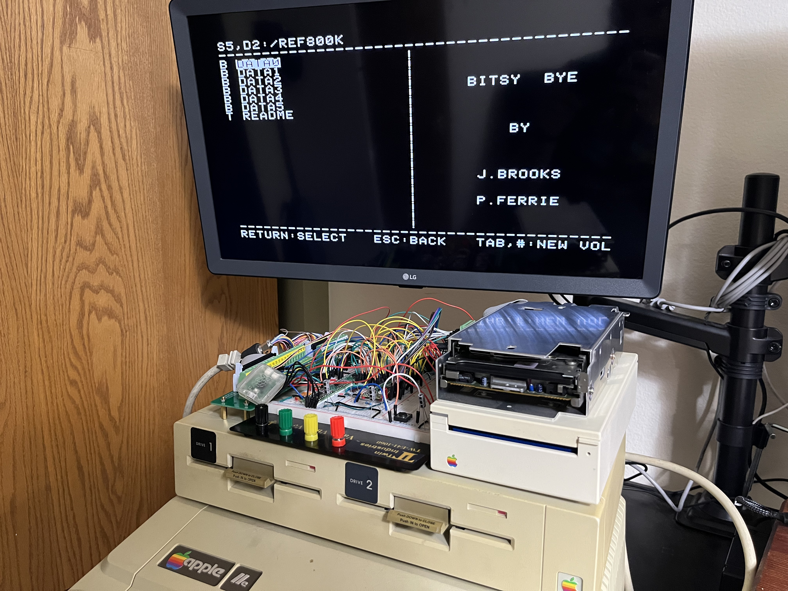

# A2M2053 Controller

A replacement controller board for the Apple UniDisk 3.5 (A2M2053).



## Overview

The UniDisk 3.5 is Apple's 800K drive for the Apple II. When its controller
board (IF-83, service part 661-0307) dies, there's nothing to fix it with. The
board is built around a Sony CXD1013 gate array that has no public datasheet
and no replacement, and the only spare board on eBay has sat unsold at $150
for months.

This project replaces the whole board. A Raspberry Pi RP2350 speaks SmartPort
to the Apple IIe through the Liron card and drives the stock Sony 800K
mechanism directly through its 20-pin connector. The 65C02, ROM, RAM, IWM and
the CXD1013 are all gone. The mechanism, the case and the front panel stay.

It isn't a clone of the original. The firmware is new C on the Pico SDK. The
original drive ROM is used as a test oracle for SmartPort behavior, status
codes, errors and timing, never as a template.

## Features

- SmartPort device on the Liron card: STATUS, READBLOCK, WRITEBLOCK, FORMAT,
  CONTROL (eject), INIT
- Reads, writes and formats 800K double-sided ProDOS disks
- Daisy chain out the rear DB-19, in front of or behind another drive
- Front-panel eject button and in-use LED
- Runs from the Apple's own +5V and +12V rails through the host cable
- Whole-track read buffer on its own core; every write verified on the next
  revolution
- USB console for bring-up: mechanism status, raw flux capture, block reads,
  whole-disk scans, bus counters

## Scope

Apple IIe with 800K double-sided ProDOS disks. Macintosh disks (524-byte
blocks, Mac interleave) and 400K single-sided disks show up in Apple's docs
and the drive ROM but were never used on the IIe, so they're out of scope.

## Specifications

| Parameter | Value |
|---|---|
| MCU | RP2350A on a Raspberry Pi Pico 2 (prototype) |
| Level shifting | 5x SN74LVC8T245, 3.3V to 5V, one DIR and /OE per 8 channels |
| GPIO | 25 of 26 used |
| Host interface | SmartPort, Liron card DB-19 (CN102) |
| Mechanism interface | Sony 800K 20-pin (CN104, ERS 699-0321) |
| Mechanism | Stock Sony 800K double-sided, CX23077A logic + CX20185 read/write amp |
| Rear port | DB-19 daisy chain: PH3_OUT, ENBL_OUT, LASTONE/ |
| Power | +5V and +12V from the host connector; Pico VSYS from +5V through a diode |

## Architecture

```
 Apple IIe / Liron card                                  Sony 800K mechanism
         | DB-19                                                | 20-pin
   [level shifters]                                    [level shifters]
         |                                                      |
   PIO0: SmartPort FM rx/tx                     PIO1: flux capture / GCR write
   PIO2: rear-port pass-through                                 |
         |                                                      |
   CORE 0: SmartPort device  <---- block request queue ---->  CORE 1: mechanism
   - bus phases, packets                                      - status, seek, motor, eject
   - commands, DIB, status                                    - speed zones
   - daisy-chain ID, LASTONE/                                 - whole-track buffer
                                                              - GCR decode/encode
```

Each SmartPort read, write or format becomes a request to core 1. Core 0
holds ACK until the answer is back, and the Liron card waits.

## Project status

**Perfboard prototype: done** (October 2026). Milestones M0 to M9 passed on
the bench with a Pico 2, five 8T245 breakout boards and a mechanism from a
dead UniDisk.

| Milestone | What | Log |
|---|---|---|
| M0 | Bench rig, power, shifter boot safety | [m0](docs/build_log/m0.md) |
| M1 | Mechanism status reads | [m1](docs/build_log/m1.md) |
| M2 | Mechanism commands: motor, seek, eject | [m2](docs/build_log/m2.md) |
| M3 | Raw flux capture, decoded on the Mac | [m3](docs/build_log/m3.md) |
| M4 | Whole disk read on the board | [m4](docs/build_log/m4.md) |
| M5 | Write and format; the working UniDisk reads our disk | [m5](docs/build_log/m5.md) |
| M6 | SmartPort on the RP2350; ProDOS boots from a RAM disk | [m6](docs/build_log/m6.md) |
| M7 | ProDOS boots from a real floppy through the Liron card | [m7](docs/build_log/m7.md) |
| M7.5 | Bench supply retired; runs on the IIe rails | [m7_5](docs/build_log/m7_5.md) |
| M8 | Daisy chain with a working UniDisk, both orders | [m8](docs/build_log/m8.md) |
| M9 | Disk swaps, write-protect, ejects, resets, long runs | [m9](docs/build_log/m9.md) |

**Drop-in PCB: in design.** The outline matches the IF-83 and fits the
original mounting holes and case opening (checked with 3D prints). The board
must stay hand-solderable and well under the $150 the spare board couldn't
sell for. Requirements carried from the bench: [FABRICATION.md](FABRICATION.md).

Build notes and photos are also on
[bytehamr.com](https://bytehamr.com/projects/unidisk-controller/).

## Repository structure

```
a2m2053_controller/
├── firmware/            # RP2350 firmware (C, Pico SDK)
│   ├── src/             # SmartPort, mechanism server, PIO programs, console
│   └── test/            # Host-side unit tests (fake drive, simulated Liron card)
├── tools/
│   ├── a2m/             # Python: console client, flux decode, GCR, PIO model
│   ├── apple/           # Test disk builders and SPCOMPARE (Applesoft)
│   └── tests/           # pytest
├── hardware/kicad/      # KiCad schematic and PCB
├── docs/
│   ├── build_log/       # Per-milestone notes and measurements
│   ├── captures/        # Scope shots, Apple screens, console logs
│   ├── photos/          # Bench photos
│   ├── superpowers/specs/  # Design spec
│   ├── research_notes.md   # Facts with sources; start here
│   ├── level_shifting.md   # Signal directions and shifter grouping
│   └── pin_budget.md       # GPIO map
└── FABRICATION.md       # PCB requirements and part choices
```

## Getting started

### Prerequisites

- [Pico SDK](https://github.com/raspberrypi/pico-sdk) 2.2.0, CMake, Ninja,
  arm-none-eabi-gcc
- A Raspberry Pi Debug Probe (or picoprobe) and Raspberry Pi's OpenOCD build
  for SWD flashing
- Python 3 for the tools (`tools/requirements.txt`)
- [AppleCommander](https://applecommander.github.io/) and
  [ADTPro](https://adtpro.com/) for the test disks

### Building and flashing

```bash
cd firmware
make            # build
make test       # host-side unit tests
make flash      # program over SWD (OpenOCD)
make reset      # reset the target
```

Tool paths live in `.env.local` at the repo root, git-ignored. Copy
`.env.example`, fill in `PICO_SDK_PATH` and, if they are not on your PATH,
`OPENOCD` and `GDB`. Anything already in your environment or on the `make`
command line wins over the file. The test-disk scripts in `tools/apple/` read
`AC_JAR` and `PRODOS_SRC` from the same file.

### Console

The firmware exposes a USB CDC console. `help` lists the commands: mechanism
status and control, flux capture, block reads and writes, whole-disk scans,
format, and `sp` for the SmartPort bus state and counters. The Python tool
drives the console for the scripted jobs:

```bash
cd tools
python -m a2m.cli readdisk --port /dev/cu.usbmodemXXXX --out disk.po --compare ref.po
```

## Design references

This project builds on:

- [Byte Hamr](https://github.com/robertrico/project_byte_hamr): the PicoPort
  SmartPort device for the RP2040 (the FM receive/transmit PIO programs and
  packet layout started there), its IWM work, and the annotated drive ROM
  disassembly by Eric Smith used as the oracle.
- [bitsavers](http://www.bitsavers.org/pdf/apple/disk/sony/): Sony 800K
  drive ERS (699-0321), mechanism schematics, Apple drive command and status
  codes.
- [tashnotes](https://github.com/lampmerchant/tashnotes): GCR checksum and
  drive command tables.
- Apple II Technical Notes (UniDisk 3.5 #1-#5, Misc #6) and the IWM
  specifications, via the [Asimov archive](https://www.apple.asimov.net/).

Datasheets, Apple and Sony documents, and photos of other people's boards
were used during the work but aren't ours to host, so they're not in this
repo. [docs/SOURCES.md](docs/SOURCES.md) says where each one came from.

## License

This project is released under the [MIT License](LICENSE.md).

## Author

Robert Rico
