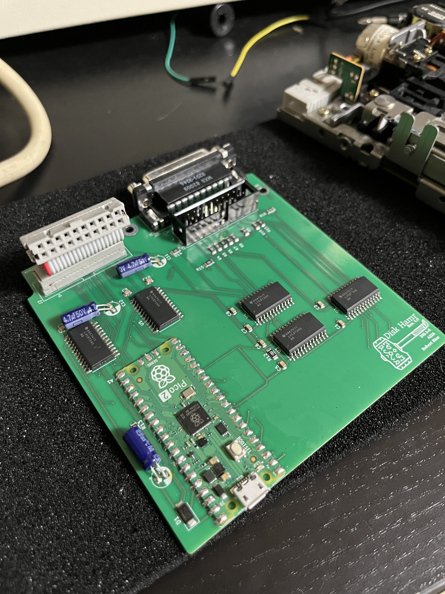
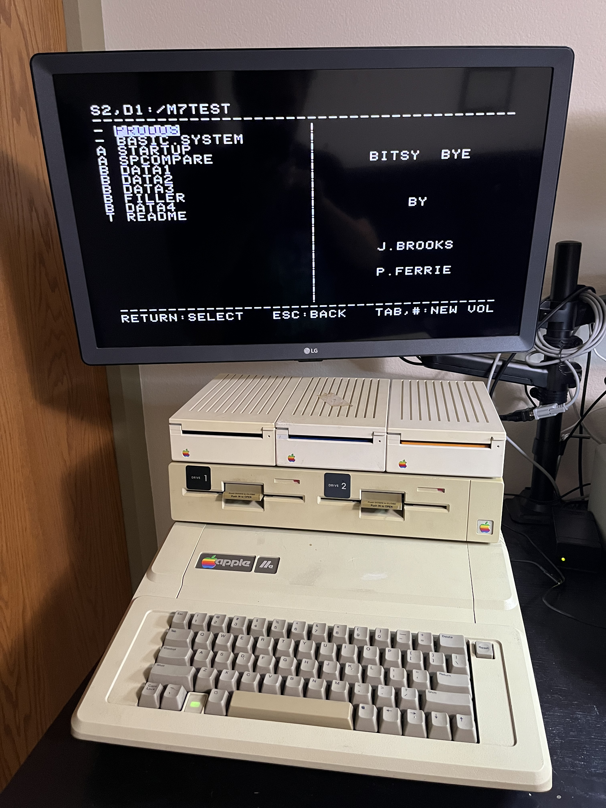
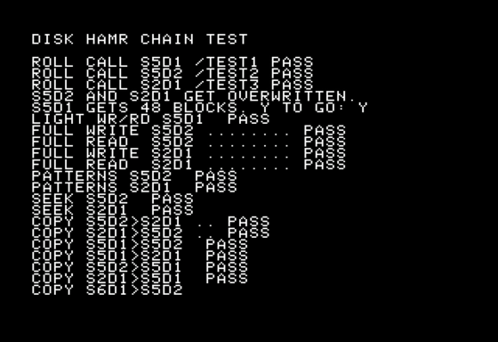
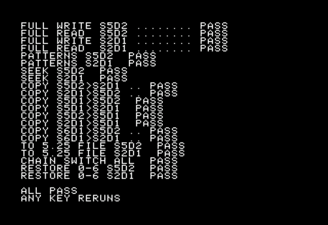

# PCB rev 1.0: first board on the Apple

2026-11-13 and 2026-11-14. The first assembled Disk Hamr rev 1.0 on the IIe
through the Liron card, running the M9 firmware.

State at the end: board 1 answers the Liron card, reads floppies and works
in the daisy chain. Getting there took one soldering fault on the board, and
one cabling mistake that cost a level shifter and the Liron card's IWM.
Board 2 came up on the first try.

The four gates in `PCB_BRINGUP.md` were not run on this board. It went on
the Apple first. The checks that were run are listed below; the
manual's "Tested on" section is unchanged.

Console log with every reading: `docs/captures/pcb_rev1/2026-11-13_console.log`.

## Board 1

### Fault 1: no ACK, U3 direction pin not soldered

Symptom: the IIe boots, the drive is never found. With the mechanism
unplugged ProDOS reports NO DEVICE CONNECTED. Every boot logged the same
three lines:

```
SPL RESET
SPL CMD     d=1 c=05 b=0 s=40 ack=6
SPL TIMEOUT d=1 c=05 b=0 s=40 stage=4
```

The board saw the bus reset and decoded INIT with no checksum error, pulled
ACK low on GP9 4 to 7 us after the packet, then waited 1 s for the card to
raise REQ for the reply (`sp_bus.c`, stage 4). The card never did.
`replies=0`. Stage 4 does not appear in any prototype log.

Ruled out first, by meter and by substitution:

- Every wanted connection on the ACK, RD and U3 /OE nets beeps, pad to pad.
- The host cable carries DB-19 pin 10 to J3 pin 20 (ACK) and not to pin 19.
- Idle voltages on U3 are right.
- The Liron card boots the working UniDisk.

Scope, probes in the rear DB-19 (J1) socket, which carries the host lines
straight through: CH1 ACK (hole 10), CH2 /WRREQ (hole 15), CH3 PH0 (hole
11), CH4 on the Pico. All 5 V/div, 10x, DC, trigger CH2 falling at 2.5 V,
500 us/div, 500 MSa/s. One INIT per capture, started with `PR#5`. Timing
from the saved waveforms, 100 ns per point. **[measured]**

| Capture | CH4 | Result |
|---|---|---|
| `2026-11-14_init_ack-wrreq-ph0-u3oe_500us.png` | U3 /OE (Pico pin 15, GP11) | /WRREQ low 879 us. /OE falls 4.5 us after /WRREQ rises and stays low. ACK at the DB-19 never goes below 3.5 V (mean 4.73 V). PH0 falls 157 us after /WRREQ rises: the card gave up. |
| `2026-11-14_init_ack-wrreq-ph0-gp9_500us.png` | GP9 (Pico pin 12, ACK into U3) | GP9 idles at 3.12 V. While the firmware drives it low it sits at 2.68 V (min 2.50 V) for about 190 us. ACK at the DB-19 stays at 4.82 V. |

GP9 was being driven low and held up by something stronger. Unpowered,
GP9 to GP10 reads 17 to 19 MOhm, so no solder bridge. The only other pad on
the net is U3 pin 4 (A2).

Cause: U3 pin 2 (DIR) was not making contact with its pad. With DIR not
high the 8T245 runs B to A. When /OE went low U3 drove its A side back at
the Pico: B2 (ACK) sits high on its 10k pull-up, so A2 was driven high
against GP9, and the B side was never driven at all. A pad-to-pad continuity
check passes on a joint like this, and so do the idle voltages, because ACK
and RD both idle high.

Fix: U3 reflowed. The DIR pin and the RD pin were both bad joints.

A burst of boots at 09:18 to 09:20 on 2026-11-14 still shows stage 4. It was
not recorded whether those were before or after the reflow. The proof that
the fix holds is the final run below: 109 replies to 109 packets.

### Fault 2: host and mechanism cables swapped

After the U3 reflow the board was cabled back up with the host cable on J2
and the mechanism cable on J3, and the Apple was switched on. J2 and J3 are
both 2x10 box headers.

Symptoms at the time: the IIe hung after `PR#5`, the console log stayed
empty (`pkts=0 resets=0`), and U1 ran noticeably warmer than the other
shifters. Levels at the rear DB-19 with the Apple on: ACK 0.43 V, /WRREQ
3.37 V, PH0 0.66 V, against 4.81 V, 4.97 V and 0.04 V on the healthy board
earlier the same morning. **[measured]**

What the host cable lands on when it is plugged into J2, from the board
file:

| Host line (J3 pin) | J2 net | What is on that net |
|---|---|---|
| PH0, PH1, PH2 (2, 4, 6) | CA0, CA1, CA2 | U2 outputs |
| PH3 (8) | LSTRB | U2 output, 10k to GND |
| -12 V (9) | no connection | |
| /WRREQ (10) | /WRTGATE | U2 output, 10k to +5 |
| +5 V (11) | +5 V | |
| GND (12) | SEL | U2 output |
| +12 V (13, 15) | +12 V | |
| /HSTEN (14) | /ENBL | U2 output, 10k to +5 |
| RD (16) | mechanism RD | U5 input, 10k to +5 |
| HDSEL (17) | +12 V | |
| WR (18) | WRTDATA | U2 output |
| ACK (20) | +5 V | |

The rails still line up, so everything powers. The Liron's IWM outputs are
wired against U2's push-pull outputs on seven lines. /WRREQ is the worst
case: U2 holds /WRTGATE high and the IWM pulls /WRREQ low for every packet.

Damage found:

**U1.** Board unpowered, nothing plugged in: **[measured]**

| Pair | Reading |
|---|---|
| J3.11 (+5) to J3.1 (GND) | 15 Ohm |
| J3.9 (-12) to J3.8, J3.10, J3.11, J3.1 | 0.4 to 0.5 MOhm |
| Pico pin 36 (3V3) to J3.1 | 1.7 kOhm |
| J3.11 to Pico pin 36 | 1.6 kOhm |
| J3.2, J3.4, J3.6 (PH0-2) to J3.1 | 10 kOhm each |
| J3.8 (PH3) to J3.1 | 0.5 kOhm |

PH3 has the same 10k pull-down as PH0-2. R7 was pulled and measured 10k out
of circuit, so the low reading was U1 pin 18. With a new U1 fitted: +5 to
GND about 90 kOhm, PH3 to GND 10 kOhm. The old U1, out of circuit, beeps
from its VCCB pins to GND.

The swap is what killed U1. With the mechanism cable on J3, U1's inputs
see only what the mechanism's own input pins present.

**Liron card.** The working UniDisk was no longer recognised and the card's
IWM ran warm. Card out of the slot, nothing on its DB-19:

| DB-19 pin | Signal | Ohms to pin 1 | Diode mode, red on pin 1 | M6 reference (previous IWM) |
|---|---|---|---|---|
| 6 | +5 V | 48 k | | |
| 5, 7 | -12 V, +12 V | open | | |
| 11-14 | PH0-3 | 52 k each | 0.58 V each | 0.825 to 0.834 V |
| 15 | /WRREQ | 120 k | **open** | 0.925 V |
| 17 | /HSTEN | open | 0.9 V | 0.751 V |
| 19 | WR | 51 k | 0.5 V | (dead in M6) |
| 18 | RD | 57 k | 0.97 V | 0.866 V |
| 10 | ACK | 57 k | 0.97 V | 0.87 V |

Resistance shows no short and does not find the fault. Diode mode does: the
/WRREQ output has no junction left. Without /WRREQ the card cannot send a
command packet. The IWM was replaced with the one from the second dead IF-83
board and the card works again.

Cost: one SN74LVC8T245 and one IWM. Both dead IF-83 boards have now given up
their IWMs to this card.

### Checks before the board went back on the Apple

Nothing plugged in, new U1 fitted: **[measured]**

- Rails: +12 to GND, +12 to +5 and +12 to -12 all in the MOhm range. With
  the -12 V rows above, no rail reads low to another rail, to GND or to a
  neighbouring signal.
- New U1, host side: no continuity between PH0/PH1, PH1/PH2, PH2/PH3,
  PH3//WRREQ, /WRREQ//HSTEN, /HSTEN/WR.
- Bench supply on J3.11 and J3.1, 5 V, limit 0.6 A, Pico on USB, no Apple
  and no mechanism: 0.03 A. `sp` shows every host pin at its pull level:
  PH0-3 = 0, WR = 0, /WRREQ = 1, /HSTEN = 1, LASTONE = 1.

The test that moves each host line with a 1k resistor (`PCB_BRINGUP.md`
1.3) was skipped: holding a resistor across header pins by hand next to the
rail pins was judged the bigger risk. The first boot exercises the same
lines.

### Result

Rev 1 board on the IIe, repaired Liron card, boot from a floppy. Counters
since Pico power-up: **[measured]**

```
SP on id=1 last=1 pass=1 img=819200 ovl=0/384
SP disk=floppy server=on wedged=0 exec_ms last=0 max=379 mech st=00 soft=00 tries=0
SP pkts=109 acks=109 cksum=0 bad=0 ign=0 tmo=0 resets=2 rereads=0 replies=109
SP ack_us last=5 max=7 data_max=- late=0 late_entry=0
SP cmds status=2 readblk=105 writeblk=0 format=0 control=0 init=2 other=0
```

ACK delay is 7 us at most, against 4 to 6 us on the prototype (`m7.md`).

Seen at the bench and not captured: the board in the daisy chain with the
working UniDisk, and disks read through it. The per-packet lines of the boot
above were not logged; the counters cover it.

## Board 2

A second rev 1.0 board, assembled on 2026-11-14 after board 1 was working,
for the second dead drive. It came up on the first try: no rework, no fault
to find.

Two things were built differently, because board 1 was a struggle to fit
into the drive. Clearance was tight all round: against the cable to the
Apple, against the shielding parts, and on the slide fit into the carriage.

- The three electrolytics (C11, C12, C13) are laid flat on the board instead
  of standing.
- J2 is not a box header. The old 20-pin connector was reused there. The
  host cable's plug no longer fits J2, so the swap that damaged board 1
  cannot happen on this board.



Board 1 for comparison, with standing capacitors and two box headers:
`docs/photos/pcb_rev1/2026-11-13_board1-assembled.jpg`, and on its drive
with both cables in, `2026-11-14_board1-on-drive.jpg`. Paste and reflow
photos are in the same folder.

Reported from the bench, with no console capture and no counters. Which
checks were made before power was not recorded.

## All three drives

2026-11-14, 14:52. Three UniDisk 3.5 drives on the IIe at once: the
working original on its own controller board, and two A2M2053s running
Disk Hamr rev 1.0 boards. Bitsy Bye lists the M7 test disk
at `S2,D1`. ProDOS gives slot 5 two drives and maps a third SmartPort
device to slot 2, drive 1, so that listing is the third drive in the chain.
**[photo]**



Not recorded: the order of the drives in the chain, and which one holds the
disk in the listing.

## Chain test from the Apple

2026-11-16, about 09:47 to 10:22. `HAMRTEST.SYSTEM`
(`tools/apple/hamrtest.s`) booted from a 5.25 floppy in slot 6 and ran
against all three drives through ProDOS block calls. Blank ProDOS disks
`/TEST1`, `/TEST2`, `/TEST3`. The stock UniDisk was S5,D1 and the two
Disk Hamr drives were S5,D2 and S2,D1, as reported from the bench. All 25
steps passed. **[photo]**




| Step | Drives | What |
|---|---|---|
| Roll call | all three | ProDOS volume header, 1600 blocks |
| Light write and read | S5,D1 | 16 blocks spread over the disk |
| Full write, full read | S5,D2 and S2,D1 | all 1600 blocks, each stamped with block number, drive and pseudo-random data, read back and compared |
| Patterns | S5,D2 and S2,D1 | `$00`, `$FF`, `$AA`, `$55` on 20 blocks |
| Seek | S5,D2 and S2,D1 | 50 pairs of block 0 / 1599 closing inward, then 100 scattered blocks, each compared |
| Copy 3.5 to 3.5 | all three | 200 blocks each way between the two Disk Hamr drives, 16 blocks each way between the stock drive and each of them |
| Copy 5.25 to 3.5 | S5,D2 and S2,D1 | the boot floppy's 280 blocks, compared against the floppy |
| 3.5 to a 5.25 file | S5,D2 and S2,D1 | 32 blocks into a scratch file and back |
| Chain switch | all three | one block from each drive in turn, 50 rounds |
| Restore | S5,D2 and S2,D1 | blocks 0-6 put back and read back |

Timing, read off screen captures taken every 1 to 3 minutes, so rough: a
full write took 6 to 8 minutes per drive, a full read under 2 minutes, the
whole run about 35 minutes. The first 200 blocks of a full write took about
70 s and later ones about 46 s.

## Lessons

- A level shifter strap can beep and still be open. Meter DIR and /OE on the
  chip leg, and check them powered. An 8T245 with DIR floating looks fine at
  idle on any line that idles high.
- When a driven line does not move, scope the driver's own pin before
  suspecting what it drives. GP9 at 2.68 V named the fault in one capture.
- J2 and J3 can be swapped, and the swap damages the host. On a board meant
  for other people to fit, that has to be designed out.
- An IWM output that has failed open reads normal on resistance. Use diode
  mode, red on ground, as in M6.
- The SN74LVC8T245 pinout is pin 1 VCCA, pin 2 DIR. `PCB_BRINGUP.md` had the
  two the other way round and is corrected.

## Next

- Board 3: a third rev 1.0 board, when another dead UniDisk turns up. Build
  it with two objectives from boards 1 and 2. First, J2 and J3 cannot be
  swapped (board 2's way: a different connector at J2). Second, it fits
  without a fight: capacitors laid flat, and the three clearances checked
  as it goes together, against the cable to the Apple, the shielding parts
  and the slide into the carriage. Take dimensions this time.
- Rev 1.1 is open: no board change is decided. What board 3 shows goes into
  it. Candidates so far: J2 and J3 that cannot be swapped by design, series
  resistors on the U2 outputs so a wrong cable cannot burn a host output,
  silk labels on both headers, footprints for flat or lower capacitors, and
  a swap warning in the manual.

Decided 2026-11-16: the `PCB_BRINGUP.md` gates will not be run, and the
rails, +5 at a chained drive and the `sp` counters will not be measured on
these two boards. Both drives passed the chain test above, and that is the
acceptance test. Rev 1.1 is the only open item.
